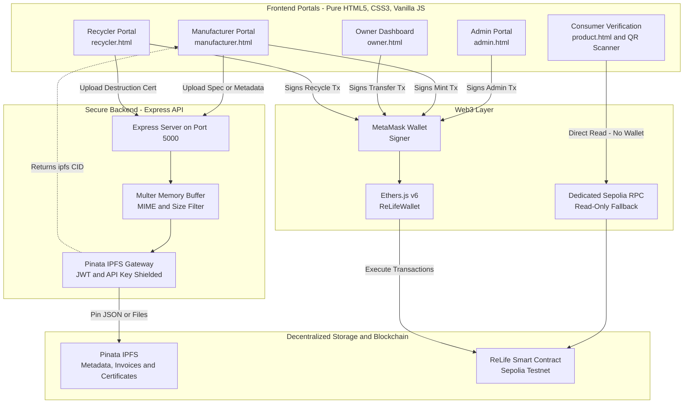

# ReLife: Blockchain-Based Digital Product Passport (DPP)

> **An immutable, transparent, and circular Digital Product Passport system built on Ethereum Sepolia and decentralized IPFS, tracking physical products from manufacturing to circular recycling.**

[](https://soliditylang.org/)
[](https://hardhat.org/)
[](https://docs.ethers.org/v6/)
[](https://sepolia.etherscan.io/)
[](https://pinata.cloud/)
[]()
[](LICENSE)

---

## 1. Executive Summary: Problem & Solution

### The Problem
Physical consumer products (electronics, luxury goods, industrial machinery) suffer from opaque supply chains, rampant counterfeiting, fraudulent warranty claims, and zero visibility into circular recycling. Secondary market buyers have no reliable way to verify authentic repair history or component authenticity, and manufacturers lack auditable mechanisms to comply with emerging environmental regulations such as the **European Union Digital Product Passport (EU DPP) mandate**.

### The ReLife Solution
**ReLife** establishes a verifiable, tamper-evident digital identity for every physical product on the Ethereum blockchain:
* **Cryptographic Identity**: Each product receives a 1-based sequential on-chain ID anchored to its physical etched serial number and decentralized IPFS metadata (origin, materials, carbon footprint).
* **Role-Governed Lifecycle**: Granular access control ensures that only authorized manufacturers can mint passports, only certified repair centers can record maintenance, and only licensed recyclers can decommission assets.
* **Deterministic Status State Machine**: Enforces a formal on-chain state machine (`Manufactured -> Sold -> InRepair -> Recycled`) with invalid move guards, repair transfer locks, and terminal recycling freeze.
* **Dynamic Warranty Expiry Tracking**: Stores verifiable `warrantyStart` and `warrantyEnd` timestamps set by manufacturers or authorized sellers; evaluates real-time validity on-chain via free `isWarrantyValid` view function with days-remaining countdown.
* **Resilient 2-Step Ownership Transfer**: Implements `initiateTransfer` and `acceptTransfer` with `cancelTransfer` fallback, eliminating accidental loss of passports to mistyped addresses and enforcing locks during repairs or decommissioning.
* **Secondary Market Pedigree**: Auditable chain of custody records every owner transition on-chain without exposing customer Personally Identifiable Information (PII).
* **Terminal Recycling Freeze**: Decommissioned hardware is permanently flagged as recycled on-chain, preventing counterfeit resurrection of discarded serial numbers.
* **Frictionless Consumer Verification**: Anyone can scan a physical QR code on a smartphone to audit product pedigree and warranty status **without installing a wallet or paying gas fees**.

---

## 2. System Architecture & Components



### Components Matrix

| Component | Technology | File Location | Responsibility |
| :--- | :--- | :--- | :--- |
| **Smart Contract** | Solidity `0.8.24` + OpenZeppelin | `contracts/ReLife.sol` | Single source of truth for passports, roles, repair logs, warranties, custody, and recycling locks. |
| **Backend API** | Node.js + Express | `backend/server.js` | Shields Pinata IPFS keys from the browser; enforces MIME validation and payload sanity. |
| **IPFS Gateway** | Pinata REST API / Mock | `backend/pinataService.js` | Pins passport metadata JSON, technical manuals, and destruction certificates to IPFS. |
| **Web3 Client** | Ethers.js v6 | `frontend/js/wallet.js` | Manages MetaMask connections, multi-provider resolution, error decoding, and data normalization. |
| **Admin Portal** | HTML5 / CSS3 / ES6 JS | `frontend/admin.html` | Participant onboarding, role governance, and event-driven audit directory. |
| **Manufacturer Portal** | HTML5 / CSS3 / ES6 JS | `frontend/manufacturer.html` | Passport registration, metadata generation, and registered inventory tracking. |
| **Owner Dashboard** | HTML5 / CSS3 / ES6 JS | `frontend/owner.html` | Displays owned assets, active warranty status, and peer-to-peer ownership transfers. |
| **Recycler Portal** | HTML5 / CSS3 / ES6 JS | `frontend/recycler.html` | Certificate upload and permanent terminal lifecycle decommissioning. |
| **Verification Portal** | HTML5 + `html5-qrcode` | `frontend/product.html` | Public authenticity lookup via URL parameter or camera QR scanner (zero gas/wallet needed). |

---

## 3. Technology Stack

* **Smart Contracts**: Solidity `0.8.24`, OpenZeppelin Contracts v5 (`AccessControl`).
* **Development Framework**: Hardhat 2 (`@nomicfoundation/hardhat-toolbox`, Chai matchers, Mocha).
* **Blockchain Client**: Ethers.js `v6.11`.
* **Target Network**: Ethereum Sepolia Testnet (Chain ID: `11155111` / `0xaa36a7`).
* **Backend Runtime**: Node.js v18+, Express, Multer (in-memory buffer storage), Axios, dotenv.
* **Decentralized Storage**: Pinata IPFS (with seamless offline mock fallback for local development).
* **Frontend Architecture**: Pure HTML5, CSS3, Vanilla ES6+ JavaScript (Zero complex bundlers like Webpack/Vite for beginner clarity and instant serving).
* **QR Tooling**: `qrcode.min.js` (client-side dynamic SVG/canvas rendering) & `html5-qrcode.min.js` (camera scanner).

---

## 4. Live Deployed Sepolia Contract

The ReLife core contract is deployed and verified on Ethereum Sepolia:

* **Contract Address**: [`0x7e8bE6a472f0638D403776B9643c914A48e6b3a6`](https://sepolia.etherscan.io/address/0x7e8bE6a472f0638D403776B9643c914A48e6b3a6)
* **Contract Administrator**: `0xd75dC45aEDDa24Bc3d3e92B03D75b828f473530E`
* **Network**: Ethereum Sepolia Testnet
* **Chain ID**: `11155111` (`0xaa36a7`)
* **Live Etherscan Explorer**: [View Verified Contract on Sepolia Etherscan](https://sepolia.etherscan.io/address/0x7e8bE6a472f0638D403776B9643c914A48e6b3a6)

---

## 5. Role-Based Access Control & Admin Governance

ReLife implements OpenZeppelin's `AccessControl` pattern with cryptographic `bytes32` role identifiers:

```text
[ DEFAULT_ADMIN_ROLE (Contract Deployer) ]
       │
       ├──► Grants/Revokes MANUFACTURER_ROLE   ──► Authorized to mint new Passports
       ├──► Grants/Revokes REPAIR_CENTER_ROLE  ──► Authorized to log Repair Records
       └──► Grants/Revokes RECYCLER_ROLE       ──► Authorized to decommission Passports
```

### Participant Roles Overview

1. **Contract Administrator (`DEFAULT_ADMIN_ROLE`)**:
   Holds super-admin governance rights. Can register authorized entities and grant or revoke operational roles.
2. **Manufacturer (`MANUFACTURER_ROLE`)**:
   Authorized to issue new product passports (`registerProduct`) and issue manufacturer warranties (`addWarranty`).
3. **Certified Repair Center (`REPAIR_CENTER_ROLE`)**:
   Authorized to append verifiable service logs and maintenance records (`addRepairRecord`).
4. **Authorized Recycler (`RECYCLER_ROLE`)**:
   Authorized to execute permanent terminal decommissioning (`addRecyclingRecord`).
5. **Product Owner**:
   Any standard Ethereum wallet holding custody of a product passport. Authorized to transfer ownership (`transferOwnership`) to another address.

### How to Onboard Participants via the Admin Portal
1. Open the Admin Portal at `http://localhost:5000/admin.html`.
2. Connect the **Contract Administrator Wallet** (`0xd75dC45...30E`).
3. Navigate to **"Onboard New Participant"**:
   * Select the participant role (e.g. *Manufacturer*).
   * Enter the participant's Ethereum address (`0x...`).
   * Enter the entity organization name (e.g. *"Acme Electronics Corp"*).
   * Click **"Authorize Participant On-Chain"** and approve the MetaMask transaction.
4. The participant is instantly granted the role on Ethereum and added to the on-chain event directory.

---

## 6. Project Structure

```text
relife-dpp/
├── contracts/
│   └── ReLife.sol            # Core smart contract with AccessControl, passports, repairs, ownership & recycling
├── test/
│   ├── setup.test.js         # Harness & environment verification
│   ├── ReLife.test.js        # Core contract unit tests (100% method coverage)
│   ├── Deployment.test.js    # Deployment artifact and ABI export verification
│   ├── backend.test.js       # Express API, Pinata IPFS, input validation & secret isolation tests
│   ├── frontend.test.js      # Frontend files, form validation, wallet module & routing tests
│   ├── verification.test.js  # Verification portal, dynamic QR generator & camera scanner tests
│   ├── owner.test.js         # Owner dashboard & transfer frontend verification
│   ├── recycler.test.js      # Recycler portal & decommissioning frontend verification
│   ├── admin.test.js         # Admin dashboard, role governance & participant directory verification
│   └── gasReport.test.js     # Gas consumption profiling and optimization benchmarks
├── scripts/
│   ├── checkNetwork.js       # Pre-flight network and RPC connectivity verification
│   ├── deploy.js             # Universal deployment script (Hardhat, Localhost, Sepolia)
│   └── verify-deployment.js   # Verifies live deployed contract bytecode and admin status
├── backend/
│   ├── server.js             # Express API server entry point & static frontend server
│   ├── pinataService.js       # Pinata IPFS service with local mock fallback
│   ├── routes/
│   │   └── ipfs.js           # Metadata & file upload routes with validation
│   └── contract-data.json    # Exported contract configuration for backend
├── frontend/                  # Vanilla HTML5, CSS3, JavaScript frontend (Zero Bundlers)
│   ├── index.html            # Landing page with live blockchain stats
│   ├── manufacturer.html     # Manufacturer portal with role-gated product registration
│   ├── owner.html            # Owner dashboard for managing assets & transferring ownership
│   ├── recycler.html         # Recycler portal for terminal decommissioning & recovery logs
│   ├── product.html          # Consumer verification portal with live QR & camera scanner
│   ├── admin.html            # Admin portal for participant onboarding & role governance
│   ├── css/
│   │   └── styles.css        # Clean, modern responsive stylesheet
│   ├── js/
│   │   ├── wallet.js         # Shared MetaMask Ethers.js v6 wallet manager & friendly error parser
│   │   ├── manufacturer.js   # Manufacturer dashboard controller
│   │   ├── owner.js          # Owner dashboard controller & transfer logic
│   │   ├── recycler.js       # Recycler dashboard controller & decommissioning logic
│   │   ├── product.js        # Consumer verification controller & scanner logic
│   │   └── admin.js          # Admin dashboard controller & event directory
│   ├── contract-data.json    # Exported contract configuration
│   └── contract-data.js      # Browser script export for zero-bundler integration
├── hardhat.config.js         # Hardhat configuration & network settings
├── .env.example              # Template for environment variables and API keys
├── .gitignore                # Git ignore rules (secrets & build artifacts)
├── PROGRESS.md               # Project phase tracking & status
├── DECISIONS.md              # Architectural design decisions (ADR log)
├── LEARN.md                  # Comprehensive concept guide & 36 university viva questions
├── DEMO_SCRIPT.md            # 5-minute live demo and presentation script
└── PROJECT_SPEC.md           # Complete system specification
```

---

## 7. Step-by-Step Setup & Installation

### Prerequisites
* **Node.js**: `v18.0.0` or higher (tested on Node v20 & v24)
* **npm**: `v9.0.0` or higher
* **MetaMask Extension**: Installed in Chrome, Brave, or Firefox
* **Git**: Installed on your system

### 1. Clone the Repository
```bash
git clone https://github.com/YOUR_USERNAME/relife-dpp.git
cd relife-dpp
```

### 2. Install Dependencies
```bash
npm install
```

### 3. Configure Environment Variables
Copy the `.env.example` template to `.env`:
```bash
cp .env.example .env
```
Open `.env` and fill in your keys (if deploying to Sepolia or using live Pinata):
```env
SEPOLIA_RPC_URL=https://eth-sepolia.g.alchemy.com/v2/YOUR_ALCHEMY_KEY
PRIVATE_KEY=your_64_character_hex_private_key_without_0x
PINATA_JWT=your_pinata_jwt_token_here
PORT=5000
```
> **Note**: If you don't have a Pinata account yet, ReLife automatically runs in **Development Mock Mode** out of the box, generating deterministic cryptographic CIDs locally!

### 4. Compile Smart Contracts
```bash
npx hardhat compile
```

### 5. Run the Automated Test Suite
```bash
npm test
```
*Executes all 161 tests across contract logic, gas benchmarks, state machines, warranty validity, 2-step ownership transfers, backend API validation, and frontend integration.*

### 6. (Optional) Deploy to Sepolia Testnet
To deploy a new contract instance to Ethereum Sepolia:
```bash
npx hardhat run scripts/deploy.js --network sepolia
```

### 7. Start the Local Server
```bash
npm start
```
The server starts at `http://localhost:5000`, simultaneously serving the backend IPFS proxy and all frontend web portals.

---

## 8. End-to-End Demo Walkthrough

Follow these steps for a complete live demonstration:

```text
[Step 1: Admin Onboards Manufacturer]
       │
       ▼
[Step 2: Manufacturer Registers Product #1 ("Colorful RP-2024")]
       │
       ▼
[Step 3: Consumer Verifies Authenticity via Public QR]
       │
       ▼
[Step 4: Certified Repair Center Appends Maintenance Record]
       │
       ▼
[Step 5: Current Owner Transfers Passport to Buyer]
       │
       ▼
[Step 6: Authorized Recycler Decommissions Product (Terminal Freeze)]
```

1. **Step 1 — Admin Onboarding**:
   Open `http://localhost:5000/admin.html` with your Admin wallet. Authorize a manufacturer address.
2. **Step 2 — Mint Digital Product Passport**:
   Open `http://localhost:5000/manufacturer.html` with the Manufacturer wallet. Fill in:
   * **Model**: `RP-2024`
   * **Brand**: `Colorful`
   * **Serial Number**: `SN-CRN-2056-5823`
   * **Materials**: `80% Aluminum, 15% Recycled Plastic, 5% Silicon`
   * **Carbon Footprint**: `42 kg CO2e`
   * Click **"Upload to IPFS & Mint Digital Passport"**. MetaMask prompts for approval.
3. **Step 3 — Consumer Verification (No Wallet Needed)**:
   Visit `http://localhost:5000/product.html?id=1` or scan the generated QR code. Notice that product details, IPFS metadata, and active warranty display instantly without asking for a wallet connection.
4. **Step 4 — Owner Transfer**:
   Open `http://localhost:5000/owner.html` with the owner wallet. Enter a recipient Ethereum address and click **"Confirm Transfer"**. The chain of custody updates immutably.
5. **Step 5 — Terminal Decommissioning**:
   Open `http://localhost:5000/recycler.html` with an authorized recycler wallet. Enter Product ID `1`, upload a manifest, and confirm recycling.
   Return to `product.html?id=1`: a red **"RECYCLED & DECOMMISSIONED"** badge appears, and any attempt to transfer or repair the product on-chain reverts automatically.

---

## 9. EVM Gas Consumption Profile

Every state mutation in `ReLife.sol` has been benchmarked for gas efficiency:

| Operation | Gas Used | Design Optimization |
| :--- | :---: | :--- |
| **Contract Deployment** | `2,947,616 gas` | Solidity `0.8.24` via-IR compilation, OpenZeppelin v5 minimal overhead. |
| **registerManufacturer** | `54,847 gas` | Role grant via `bytes32` constants + custom gas errors. |
| **registerRepairCenter** | `54,871 gas` | Indexed event emission instead of unbounded storage arrays. |
| **registerRecycler** | `54,934 gas` | Reusable admin onboarding state machine. |
| **registerProduct (Passport Minting)** | `418,353 gas` | Stores off-chain IPFS hash (`metadataURI`) rather than heavy strings; enforcers global serial mapping. |
| **addWarranty** | `126,156 gas` | Single `expiryTimestamp` slot; dynamic verification via free `view` function. |
| **addRepairRecord** | `260,854 gas` | Chronological dynamic array push (`O(1)` append) with off-chain diagnostics URI. |
| **transferOwnership** | `105,608 gas` | Direct storage update + immutable custody array push without PII storage. |
| **addRecyclingRecord** | `280,925 gas` | Terminal lifecycle state flip (`isRecycled = true`) preventing subsequent mutations. |
| **Read Operations (`getProduct`, `verifyProduct`)** | **`0 gas` (Free)** | EVM `view` functions executed locally via JSON-RPC node without mining fees. |

---

## 10. Security & Anti-Fraud Features

1. **Physical-to-Digital Anti-Cloning Notice**:
   A QR code on a physical sticker can be photocopied. ReLife's consumer verification UI explicitly educates consumers to cross-reference the physical etched hardware serial with the on-chain passport record and check tamper-evident seals.
2. **Terminal Decommissioning Freeze**:
   Once recycled, `_products[productId].isRecycled` is permanently set to `true`. All mutating functions (`transferOwnership`, `addRepairRecord`, `addWarranty`) strictly revert, eliminating "zombie passport" counterfeiting.
3. **Zero Secret Leakage**:
   The frontend browser contains zero private keys or Pinata secrets. All IPFS interactions pass through an Express backend that enforces strict MIME type validation and file size limits.
4. **Defensive Data Formatting & XSS Sanitization**:
   All contract outputs are passed through `ReLifeWallet.formatProduct()` and rendered using `textContent` rather than raw `innerHTML`, shielding the application from Cross-Site Scripting (XSS).

---

## 11. Known Limitations (Academic & Prototype Scope)

1. **Physical-to-Digital Anchor**: A QR code sticker alone does not cryptographically prove that the physical hardware in hand is genuine. An attacker could paste a legitimate QR code onto a counterfeit device. Production deployments should pair the passport with cryptographic NFC chips with asymmetric public-key challenge-response.
2. **Public IPFS Data**: IPFS data is distributed and publicly queryable. While this aligns with open sustainability reporting, proprietary engineering schematics or sensitive customer data must not be uploaded without client-side encryption.
3. **Test Network Environment**: The contract is deployed to Ethereum Sepolia. Block times, gas prices, and network finality on Sepolia represent a testnet environment and do not carry real monetary value.

---

## 12. Future Scope & Roadmap

* **Layer 2 Rollup Migration**: Deploy contract to Arbitrum, Optimism, or Base to reduce passport minting costs to under \$0.01 per product.
* **Cryptographic NFC / Secure Element Pairing**: Bind digital passports to tamper-proof NFC tags equipped with ECDSA challenge-response signatures.
* **Zero-Knowledge Proofs (ZKP)**: Implement zk-SNARKs allowing manufacturers to prove compliance with EU carbon limits without revealing proprietary trade secrets.
* **ERC-721 / ERC-1155 Tokenization**: Wrap passports as non-fungible tokens for cross-dApp interoperability in decentralized insurance and asset financing.

---

## 13. Presentation & Academic Viva Resources

* **Live Presentation Talk Track**: See [`DEMO_SCRIPT.md`](DEMO_SCRIPT.md) for a step-by-step 5-minute live demo script.
* **Architecture Decision Records (ADRs)**: See [`DECISIONS.md`](DECISIONS.md) for design trade-offs and rationale.
* **Comprehensive Viva & Study Guide**: See [`LEARN.md`](LEARN.md) for plain-English explanations of all concepts and answers to 36 typical university viva questions.
* **Project Progress Log**: See [`PROGRESS.md`](PROGRESS.md) for the complete phase checklist.

---

## 14. License

This project is open-source software licensed under the [MIT License](LICENSE).
